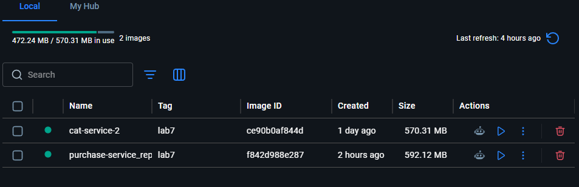

https://dbfiddle.uk/fH2fSLmr
**My answers for Week 9 lab**
**Maven is responsible for compiling my Java application, running test and packaging my application into a JAR file**
**An image is a package containing everything required to run my application. The container is an instance of an image**
**It means that -p mapping exposes container port 8081 on Windows host port 8081. EXPOSE means that this documents that 
the container applications listens on port 8082. However, EXPOSE alone does not publish the port on my computer**
**Let's say that purchase runs inside its own Docker container, localhost refers to the Purchase container itself, not 
my computer or the catalog container. Consequently, the request fails because Purchase is looking for Catalog inside its
own container**
**The Catalog Product survived because Docker uses a named volume to store database data outside the container. When 
docker compose down removes the container, the named volume remains intact. When I run docker compose up -d again, 
Docker attaches the existing volume to the new container, allowing the application to access the previously stored
data.**
